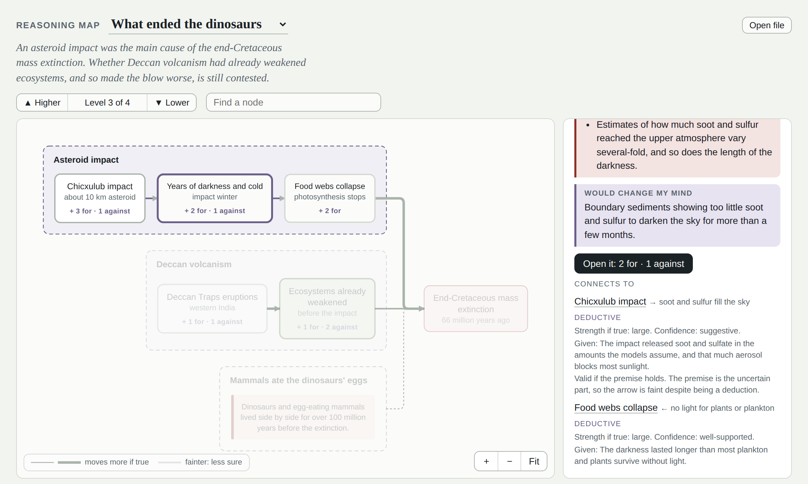

# Viewer

One example renderer for the protocol. A single HTML file: it reads map files and knows nothing else about them. Delete it and every map still reads as a complete model.



## Open it

```
python3 -m http.server        # from the repo root
```

Then open http://localhost:8000/viewer/. It loads the files in [examples/](../examples/). Other ways in:

- `viewer/?map=URL` loads any map by URL; repeat `map=` for several.
- **Open file**, or drag a `.json` file onto the canvas. This also works when `index.html` is opened straight from disk, where browsers block loading the examples.

## How it draws a map

- **Opening a box goes one level down**: its parts, or its evidence for and against as green and red cards. Level of detail is the ▲ ▼ control.
- **Arrows roll up.** An arrow between hidden boxes is drawn between the visible boxes that contain them.
- **Width is strength, faintness is confidence.** A thick faint arrow reads "big if true, not established". The inference type, premises and notes are in the side panel, so uncertainty is not drawn twice.
- **The root is the canvas**, not a box. Arrows into the root are not drawn, so give the outcome its own node (as both examples do).
- Node order matters for layout: list causes before what they cause, and the flow reads left to right (top to bottom on a phone).

Layout is [ELK](https://eclipse.dev/elk/) (layered, orthogonal arrows), drawn as SVG. Works on a phone.

## Driving it from code, chat or voice

Every button goes through one small API on `window.reasoningMap`: `load(map)`, `openMap(id)`, `setAltitude(level)`, `explode(id)`, `implode(id)`, `focus(id)`, `select(id)`, and `describe()`, which returns the current screen as plain text. A chat or voice layer only has to call these; nothing in the map files changes.
